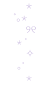
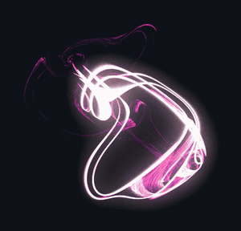

### Hi, I'm Anusha&nbsp;&nbsp;&nbsp;ฅ₍^•⩊ •マⳊ

AI student at King's, building tech that reads the body.

  &nbsp;&nbsp;

#### ▶ deck A · now playing

- **EMG suit** reads muscles and movement and drives live visuals (my forearm is driving the one above). Started in [emg-scope](https://github.com/anushaisawesome/emg-scope). too many hours spent debugging this lol… thanks for sending me fakes aliexpress 😭

- **Bionic eye encoder** the software that decides what the brain sees. what a sight to see…

#### ♪ tracklist

`01` **[Unseen Steps](https://github.com/anushaisawesome/unseen-steps)** 🏆 live AI audio description of dance · Google DeepMind prize · [demo](https://youtu.be/4aadm47Nk1g)

`02` **[Wayfinder](https://github.com/anushaisawesome/wayfinder)** robot guide dog for sight loss, built solo

`03` **[UniBots ball detection](https://github.com/anushaisawesome/unibots-yolo)** 97.1% mAP on our competition robot

`04` **[Wise LifeSwitch](https://github.com/akshyaprakkash05/Wise-LifeSwitch-IKU-Hack)** group bill splitting · IKU hack

`05` **LinerNotes** saving moments in songs (in progress)

`06` **[Robin](https://github.com/anushaisawesome/robin-assistant)** · `07` **[Emotify](https://github.com/anushaisawesome/emotify-spotify-app)**

#### ⚙ stack

#### ♡ outside of code

DJing, dancing with KCL Hallyu, and taking the photos at robotics events.

#### ✉ say hi

[LinkedIn](https://www.linkedin.com/in/anushaisawesome)

thanks for stopping by ฅ^•ﻌ•^ฅ
